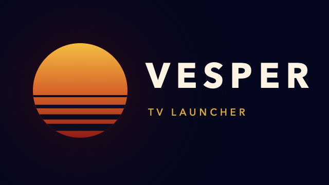

# Vesper



Launcher minimalista para Google TV (probado en Onn 4K, Android 14). Inicio con accesos, "Seguir viendo" y apps; reposo con obras de la National Gallery of Art.

## Compilar

```bash
export JAVA_HOME="/Applications/Android Studio.app/Contents/jbr/Contents/Home"
./gradlew :app:testDebugUnitTest          # tests
./gradlew :app:assembleRelease            # app/build/outputs/apk/release/app-release.apk
python3 -I -m unittest discover -s tools/art -t tools/art   # tests del selector de arte
```

## Instalar en la TV

Activa la depuración inalámbrica en la TV y usa su `IP:puerto`:

```bash
adb connect 192.168.1.XX:PUERTO
adb install -r app/build/outputs/apk/release/app-release.apk
```

Luego elige Vesper en **Configuración > Apps > App de inicio predeterminada**.

### Que la tecla HOME abra Vesper

En Google TV el home de Google tiene prioridad sobre cualquier launcher de terceros, así que el rol de inicio no basta. Vesper incluye un servicio de accesibilidad que detecta la tecla HOME y la aparición del home de Google, y abre el launcher en su lugar (no lee el contenido de la pantalla ni deshabilita el home de Google; puede verse un destello breve). Actívalo una vez en **Configuración > Accesibilidad > Vesper · tecla HOME**, o por ADB:

```bash
adb -s IP:PUERTO shell settings put secure enabled_accessibility_services com.minimal.tvlauncher/com.minimal.tvlauncher.actions.HomeKeyService
adb -s IP:PUERTO shell settings put secure accessibility_enabled 1
```

**Importante:** si fuerzas el cierre de Vesper (Configuración > Apps > Forzar detención, o `adb shell am force-stop`), Android apaga este servicio y HOME deja de abrir el launcher. Cuando eso pasa aparece un punto ámbar sobre el icono ◐ y en sus ajustes un botón "Activar el botón HOME".

Para desactivarlo: Configuración > Accesibilidad, o `adb shell settings delete secure enabled_accessibility_services`.

## Volver al launcher anterior

Desde el app: Ajustes del launcher (icono ◐) > "Volver al launcher original". O por ADB:

```bash
tools/revert_home.sh 192.168.1.XX:PUERTO --dry-run     # ver qué haría
tools/revert_home.sh 192.168.1.XX:PUERTO               # vuelve al home de Google TV y desinstala Vesper
tools/revert_home.sh 192.168.1.XX:PUERTO --home com.spocky.projengmenu --keep   # vuelve a Projectivy, conserva Vesper
```

Si el launcher falla 3 veces seguidas al arrancar, cede el control solo al home de Google TV.

## Marca

Nombre: **Vesper** (la estrella de la tarde). Icono: un sol poniente con rayas, en la paleta del launcher. El identificador interno del app sigue siendo `com.minimal.tvlauncher` (cambiarlo rompería el rol de inicio, el servicio de accesibilidad y los datos guardados).

- Icono adaptable (vector): `app/src/main/res/drawable/ic_launcher_foreground.xml` sobre `#04071D`.
- Banner de Android TV (320×180): `app/src/main/res/drawable-xhdpi/banner.png` y `drawable-xxhdpi/`.
- PNG de marca: `branding/vesper-icon-512.png` y `branding/vesper-banner.png`.
- Regenerar banner y PNG: `swift tools/brand/make_assets.swift .`

## Diseño

Paleta de 10 tonos (azul noche a ámbar) en `ui/Theme.kt`, con roles tonales al estilo Material 3. Fondo permanente: una obra de la National Gallery bajo una capa de la paleta, que cambia cada 10 minutos. El foco es ámbar con resplandor naranja. Los iconos son monocromos cálidos y recuperan su color al enfocar.

## Actualizar el launcher

Ajustes del launcher (icono ◐) > **Buscar actualización**. El launcher consulta un `update.json` (dirección en `gradle.properties`, `updateUrl`); si hay una versión con `versionCode` mayor, ofrece **Instalar**, descarga el APK, verifica su checksum SHA-256 y abre el instalador del sistema. La primera vez Android pide permitir instalar apps desde Vesper.

Para publicar una versión nueva desde esta Mac: sube `versionCode`/`versionName` en `app/build.gradle.kts` y ejecuta

```bash
tools/publish_update.sh --notes "Qué cambió"    # compila, escribe updates/update.json y sirve la carpeta en tu red
```

Déjalo corriendo mientras la TV busca y descarga; detenlo con Ctrl-C. La actualización debe ir firmada con la misma clave (la de depuración de esta Mac).

## Controles

- **OK** abre; **mantener OK** en un app de la fila abre su pantalla de información (Forzar detención).
- **＋** abre todas las apps en tres secciones: **Favoritos** (los de la pantalla de inicio, máximo 10), **Todas las apps** y **Ocultas**. En el inicio, **mantén OK sobre ＋** para ordenar los favoritos o administrar las apps. **Mantén OK** sobre un app para moverlo, agregarlo o quitarlo de favoritos, ocultarlo o desinstalarlo.
- Sin tocar el control 5 min entra el reposo; tras 20 min de arte la pantalla queda en negro. Cualquier botón vuelve al inicio.

## Cambiar las obras del reposo

Edita `PREFERRED`/`SCENIC` en `tools/art/prepare_art.py` y ejecuta:

```bash
python3 -I tools/art/prepare_art.py --out /ruta/NUEVA/vacia --assets app/src/main/assets/art
```

Solo usa obras con marca *open access* del repo [NationalGalleryOfArt/opendata](https://github.com/NationalGalleryOfArt/opendata).

## Pruebas rápidas en depuración

```bash
adb shell am start -n com.minimal.tvlauncher/.HomeActivity --el idle_ms 12000 --el dark_ms 25000
```

Acorta los tiempos del reposo (solo en builds de depuración).

## 0.3.0

- **Actualizaciones**: el launcher consulta `update.json` cada 12 h al volver al inicio (reintenta a los 30 min si falla), avisa una vez por versión y muestra un punto ámbar sobre ◐. "Buscar actualización" en Ajustes sigue disponible. Requiere que `tools/publish_update.sh` esté sirviendo desde el Mac y permitir "instalar apps desconocidas" la primera vez.
- **Ver obra** (ojo, 5.º icono): oculta la interfaz y muestra la obra con su ficha; cualquier tecla vuelve.
- **Obra más visible**: capa de la paleta más ligera (0.34 / 0.46 / 0.86 de opacidad arriba/medio/abajo).
- **Quitar de Seguir viendo**: mantener OK sobre una tarjeta abre el menú; el descarte se recuerda hasta que vuelvas a ver ese título.
- Los menús modales bloquean el foco del fondo (`LocalFocusEnabled`) y al cerrarse devuelven el foco al elemento anterior (`FocusMemory`).
